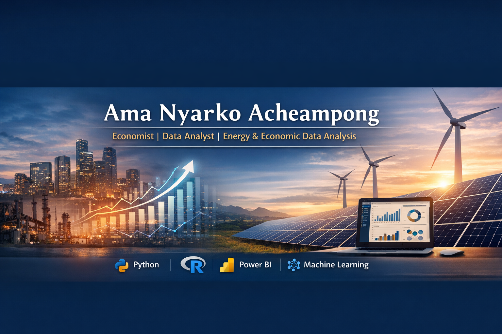

# Hi, I'm Ama Nyarko Acheampong

## About Me

I am a quantitative economist and data analyst with postgraduate degrees in Economics, Energy, Economics and Law, and an academic background in Statistics. My work sits at the intersection of economic analysis, statistical modelling, energy systems and data science, with a focus on using quantitative methods to investigate real-world economic and policy challenges.

I develop data-driven projects using Python, R and Power BI, applying statistical analysis, econometric techniques and time-series modelling to explore economic performance, electricity demand, renewable energy integration and energy market dynamics. I am interested in translating complex datasets into meaningful insights that support evidence-based research, policy evaluation and decision-making.

My broader interests include the distributional effects of economic and energy transitions, the role of data science in applied economic research, and the use of machine learning to strengthen empirical analysis. I am particularly interested in interdisciplinary approaches that connect economic theory, quantitative methods and practical policy questions.

I welcome opportunities to contribute to collaborative research, applied data science projects and interdisciplinary initiatives across economics, energy policy, sustainability and AI-assisted analytical methods.

---
## Research Interests

My research interests centre on the application of quantitative methods, econometrics and data science to economic, energy and public policy questions. I am particularly interested in how empirical research and computational approaches can improve our understanding of economic behaviour, market dynamics and the wider implications of policy and technological change.

Key areas of interest include:

**Energy Economics and Electricity Markets**: Energy demand, electricity market dynamics, affordability and the economic implications of energy price fluctuations.

**Applied Econometrics and Quantitative Research**: Statistical inference, time-series analysis, causal inference and empirical approaches to economic and policy evaluation.

**Climate Transition and Renewable Energy**: Renewable energy integration, electricity system transitions and the economic dimensions of decarbonisation.

**Machine Learning and AI in Economic Research**: Applications of machine learning, automated analytical workflows and interpretable computational methods to economic and energy datasets.

**Economic Policy and Distributional Analysis**: The effects of economic shocks, market changes and regulatory interventions on households, businesses and wider economic outcomes.

**Data-Driven Decision-Making**: The use of reproducible analytical workflows, data visualisation and quantitative evidence to inform research and policy decisions.
- ---
# Skills & Tools

### Programming

### Data Analysis & Machine Learning

### Data Visualisation

### Tools

---

# Certifications

### Google Advanced Data Analytics Professional Certificate
Issued by Google. This program covered data analysis, statistical analysis, data visualisation, and machine learning using Python.

Credential verification  
https://www.credly.com/users/ama-acheampong.15c58e14

---

### IBM Machine Learning Professional Certificate
Issued by IBM. This program focused on supervised and unsupervised learning, regression models, classification, clustering, and model evaluation.

Credential verification  
https://www.credly.com/users/ama-acheampong.15c58e14

---

- **Artificial Intelligence Foundations: Machine Learning** – LinkedIn (May 2025)  
- **Complete Guide to R: Wrangling, Visualizing, and Modeling Data** – LinkedIn (May 2025)  
- **Excel: Economic Analysis and Data Analytics** – LinkedIn (May 2025)  
- **Machine Learning** – DeepLearning.AI (May 2025)  
- **Machine Learning Statistical Foundations** – Wolfram Research (May 2025)  
- **Power BI Essential Training** – LinkedIn (May 2025)  
- **Power BI: Dashboards for Beginners** – LinkedIn (May 2025)  
- **Predictive Analytics: Data Mining** – LinkedIn (May 2025)  
- **SQL for Data Analysis** – LinkedIn (May 2025)  
- **SQL: Data Reporting and Analysis** – LinkedIn (May 2025)  

---

## Selected Research Projects

### Electricity Demand and Weather Analysis in the UK
This project investigates the relationship between electricity demand, renewable energy generation, and weather conditions in the United Kingdom.

**Data Sources**
- National Grid ESO API
- Met Office weather data

**Methods**
- API data collection
- Data cleaning and preprocessing
- Exploratory data analysis
- Data visualisation

**Repository**  
https://github.com/Ama1997/Energy-Demand-Analysis

---

### Dynamics of Electricity Prices
This project explores potential determinants of daily electricity prices using a simulated dataset designed to study electricity market dynamics.

**Methods**
- Exploratory data analysis
- Statistical modelling
- Data visualisation

**Repository**  
https://github.com/Ama1997/Dynamics-of-electricity-prices

---

### Economic Indicators Analysis
This project analyses macroeconomic indicators using Python to explore trends and relationships within economic data.

**Methods**
- Data cleaning
- Exploratory data analysis
- Economic data visualisation

**Repository**  
https://github.com/Ama1997/Economic-Analysis

---

### Renewable Energy Data Exploration
This exploratory data analysis project examines renewable energy datasets to identify patterns in energy production and sustainability indicators.

**Repository**  
https://github.com/Ama1997/renewable-energy-analysis

---

### Data Professionals Survey Dashboard
Interactive Power BI dashboard analysing survey data from professionals working in the data industry, highlighting trends in salaries, tools, and job roles.

**Repository**  
https://github.com/Ama1997/data-professionals-dashboard

---

## Methods

- Exploratory Data Analysis (EDA)
- Statistical modelling
- Machine learning
- Data visualisation
- API data collection

- ---

# Current Focus

I am strengthening my applied research and analytical capabilities at the intersection of economics, energy systems and data science, with a focus on:

**Machine Learning and AI**: Applying machine learning techniques and computational methods to empirical research and structured data analysis.

**Applied Econometrics and Economic Analysis**: Using statistical modelling, time-series analysis and quantitative methods to investigate economic trends and policy questions.

**Energy Systems and Market Analysis**: Exploring electricity demand, renewable energy integration, energy market dynamics and the economic implications of the energy transition.

**Data Visualisation and Research Communication**: Developing interactive dashboards and clear, evidence-based visualisations to communicate analytical findings to technical and non-technical audiences.

**Reproducible Research and Analytical Workflows**: Building transparent, well-documented projects that support reliable analysis, interpretation and further research.
